

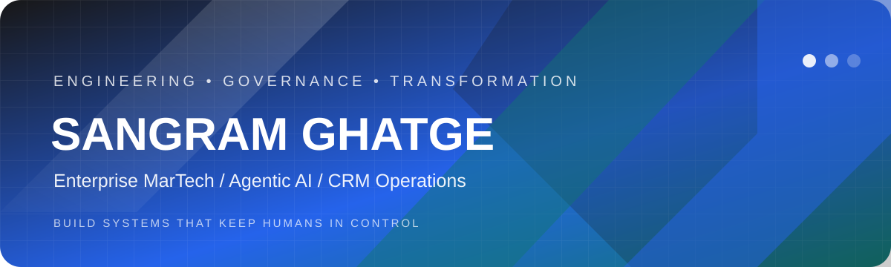

**ENTERPRISE MARTECH · AI TRANSFORMATION · AGENTIC AI · CRM OPERATIONS · AI GOVERNANCE**

**Designing governed, evidence-first systems for enterprise customer and marketing operations.**

[Explore Build Lab](https://sghatge.streamlit.app/) · [Browse repositories](https://github.com/sghatge?tab=repositories) · [Project showcase](https://github.com/sghatge/sghatge#featured-projects)

---

## About Me

I build practical systems at the intersection of enterprise CRM, marketing technology, AI-enabled operations and responsible agentic automation. This portfolio brings together independent engineering projects, reusable skills, governance patterns, interactive prototypes and applied research.

My focus is on turning complex operating processes into measurable, testable and explainable systems:

- **Enterprise MarTech:** Adobe Campaign Classic, CRM architecture, lifecycle marketing and campaign operations.
- **Customer experience:** customer data, identity resolution, journey orchestration and activation controls.
- **Agentic AI:** task-specific agents, bounded tools, structured handoffs and human-in-the-loop workflows.
- **AI governance:** policy-as-code, deterministic gates, evaluation, auditability and risk controls.
- **Engineering practice:** Python, SQL, Streamlit, GitHub Actions, automated testing and documentation.

> **Portfolio principle:** deterministic controls enforce policy; AI provides bounded assistance; humans retain accountability. Public demonstrations use synthetic or demonstration data. Never submit confidential, customer or production data to public demos.

## Featured Projects

### Visual Project Gallery — OPSFORGE Build Lab Modules

All featured modules use a consistent original SVG visual style. Each image links directly to its project repository or demo.

<table>
<tr>
<td width="50%" valign="top">

<a href="https://github.com/sghatge/opsforge">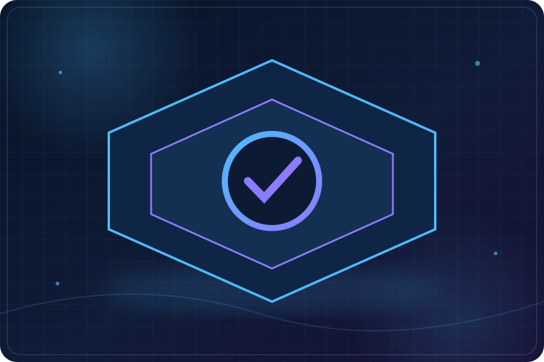</a>

**OPSFORGE** — governed AI operating model, approvals and audit ledger.

</td>
<td width="50%" valign="top">

<a href="https://github.com/sghatge/opsforge">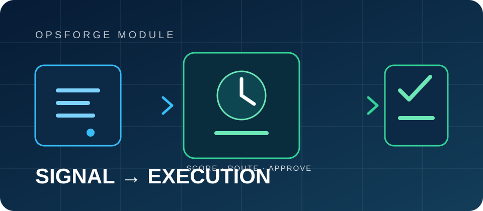</a>

**Signal → Execution** — research intake, relevance scoring and controlled decisions.

</td>
</tr>
<tr>
<td width="50%" valign="top">

<a href="https://github.com/sghatge/opsforge/tree/main/products/resilience-command-centre">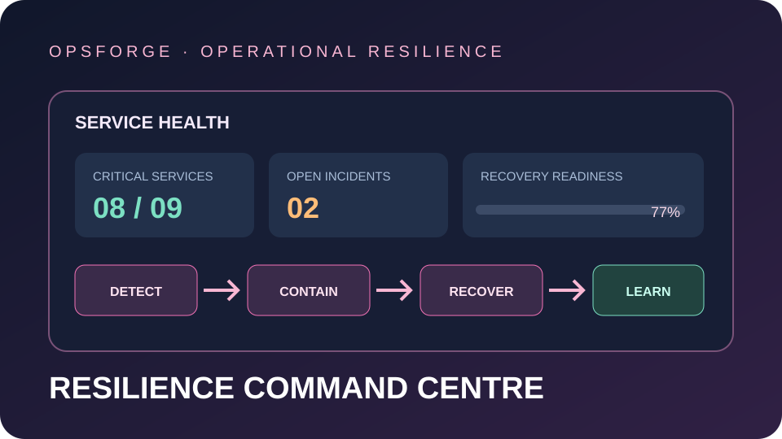</a>

**Resilience Command Centre** — structured resilience assessment and response.

</td>
<td width="50%" valign="top">

<a href="https://github.com/sghatge/acc-agent-gate">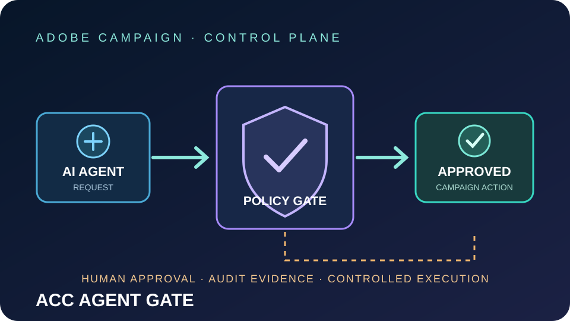</a>

**ACC Agent Gate** — policy checkpoint, human approval and auditable execution.

</td>
</tr>
<tr>
<td width="50%" valign="top">

**AJO Journey Time Machine** — replay journeys, test consent and inspect risk.

</td>
<td width="50%" valign="top">

<a href="https://github.com/sghatge/campaignpulse-ai">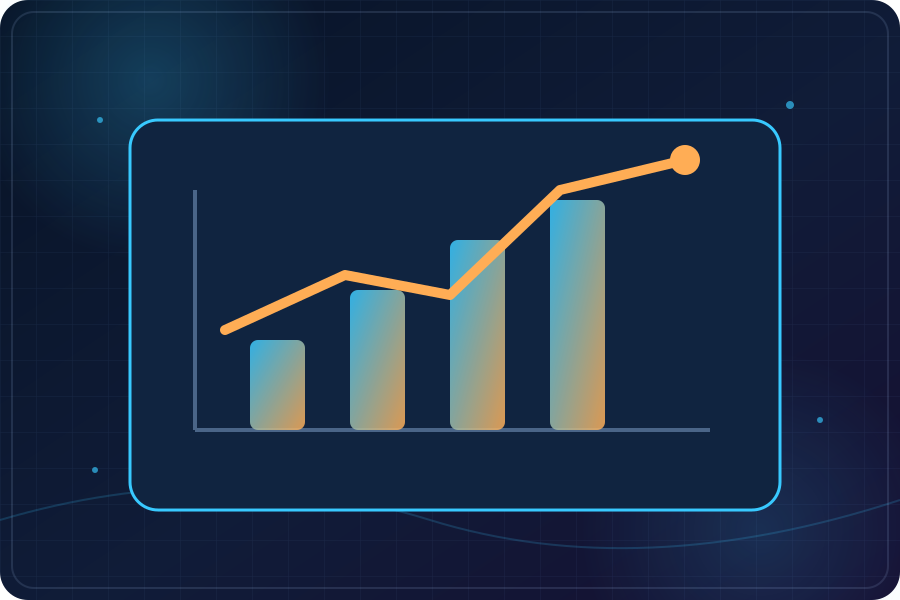</a>

**CampaignPulse AI** — campaign KPIs, diagnostics and evidence-led recommendations.

</td>
</tr>
<tr>
<td width="50%" valign="top">

<a href="https://github.com/sghatge/ai-readiness-calculator">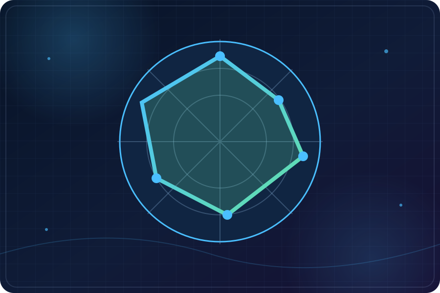</a>

**AI Readiness Calculator** — capability assessment and transformation roadmap.

</td>
<td width="50%" valign="top">

**Email 2030 Showcase** — AI-readable email, agent governance and testing concepts.

</td>
</tr>
<tr>
<td width="50%" valign="top">

<a href="https://github.com/sghatge/adobe-campaign-v8-governance">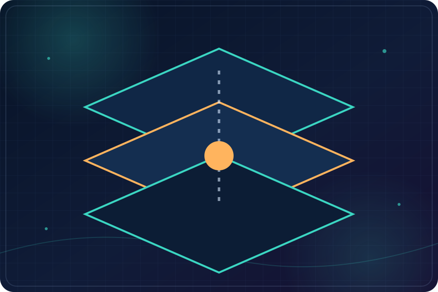</a>

**Adobe Campaign v8 Governance** — campaign QA, operational controls and evidence.

</td>
<td width="50%" valign="top">

<a href="https://github.com/sghatge/customer-360-intelligence">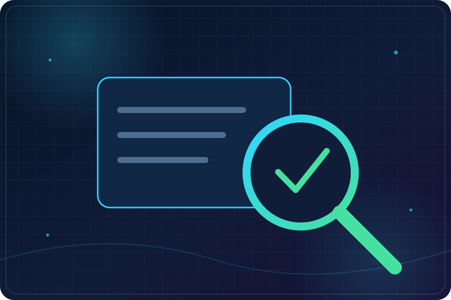</a>

**Customer 360 Intelligence** — identity, consent, audiences and activation.

</td>
</tr>
<tr>
<td width="50%" valign="top">

<a href="https://github.com/sghatge/digital-marketing-ai-agents">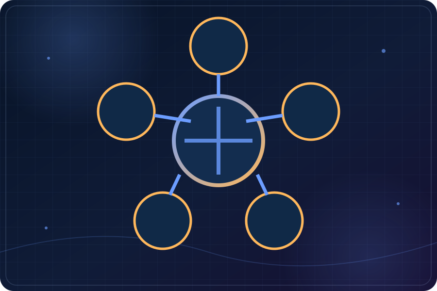</a>

**Digital Marketing AI Agents** — strategy, content, campaign QA and analytics agents.

</td>
<td width="50%" valign="top">

**Campaign v8 Pre-flight Agent** — deterministic release-readiness checks.

</td>
</tr>
<tr>
<td width="50%" valign="top">

<a href="https://github.com/sghatge/ajo-journey-orchestration-lab">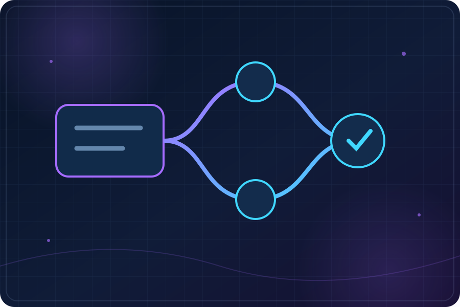</a>

**AJO Journey Orchestration Lab** — journey design and orchestration patterns.

</td>
<td width="50%" valign="top">

<a href="https://github.com/sghatge/salesforce-crm-ai-lab">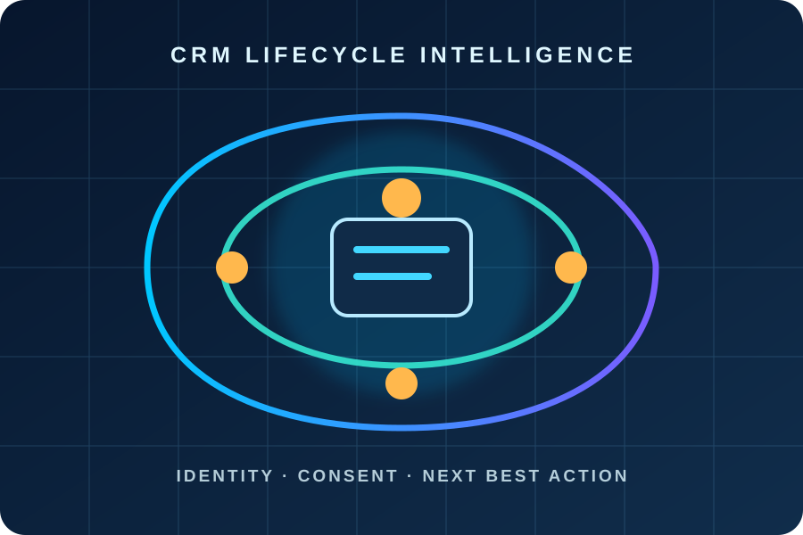</a>

**Salesforce CRM AI Lab** — CRM lifecycle intelligence and decision support.

</td>
</tr>
<tr>
<td width="50%" valign="top">

**Self-Optimizing Test Loop** — experiment, measure and improve through evidence.

</td>
<td width="50%" valign="top">

<a href="https://github.com/sghatge/email-2030-showcase/tree/main/01-prompt-to-journey">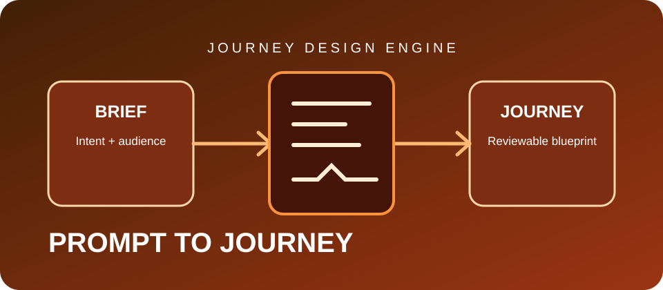</a>

**Prompt to Journey** — transform briefs into reviewable journey blueprints.

</td>
</tr>
</table>

<table>
<tr>
<td width="50%" valign="top">

### 01 · Adobe Campaign v8 Governance

Deterministic campaign QA, evidence reports, governance controls and human review.

[Repository](https://github.com/sghatge/adobe-campaign-v8-governance) · [Live site](https://sghatge.github.io/adobe-campaign-v8-governance/) · [Streamlit app](https://adobe-campaign-v8-governance-3rzwjb2pbqqftpm3fecxzd.streamlit.app/)

</td>
<td width="50%" valign="top">

### 02 · ACC Agent Gate

A policy checkpoint between AI agents and Adobe Campaign, with approval gates and tamper-evident audit records.

[Repository](https://github.com/sghatge/acc-agent-gate) · [Live demo](https://sghatge.github.io/acc-agent-gate/)

</td>
</tr>
<tr>
<td width="50%" valign="top">

### 03 · OPSFORGE

Governed AI operating patterns with bounded agents, named human approvals and auditable outcomes.

[Repository](https://github.com/sghatge/opsforge) · [Walkthrough](https://sghatge.github.io/opsforge/)

</td>
<td width="50%" valign="top">

### 04 · Customer 360 Intelligence

A hands-on AEP learning lab covering XDM, identity resolution, consent, audience design and lifecycle integration using synthetic data.

[Repository](https://github.com/sghatge/customer-360-intelligence) · [Live demo](https://sghatge.github.io/adobe-campaign-v8-governance/demos/customer-360.html)

</td>
</tr>
<tr>
<td width="50%" valign="top">

### 05 · Digital Marketing AI Agents

Interactive marketing workflows for strategy, content, campaign QA and performance analysis.

[Repository](https://github.com/sghatge/digital-marketing-ai-agents) · [Streamlit demo](https://sghatge-digital-marketing-ai-agents-app-5uhltb.streamlit.app/)

</td>
<td width="50%" valign="top">

### 06 · AJO & Salesforce Labs

Independent learning streams for journey orchestration and CRM intelligence.

[AJO repository](https://github.com/sghatge/ajo-journey-orchestration-lab) · [Salesforce repository](https://github.com/sghatge/salesforce-crm-ai-lab)

</td>
</tr>
</table>

### 07 · OPSFORGE Signal-to-Execution

Research-to-execution pipeline with public RSS intake, weighted relevance scoring, specialist agent routing, Autonomous / Notify / Approve classification, reviewer decisions and downloadable evidence ledger. External actions remain disabled.

[Repository](https://github.com/sghatge/opsforge) · [Signal pipeline source](https://github.com/sghatge/opsforge/blob/main/signal_pipeline.py)

### 08 · OPSFORGE Resilience Command Centre

A dedicated resilience workspace integrated into the OPSFORGE Streamlit showcase, alongside the signal pipeline and governed operating model.

[Repository](https://github.com/sghatge/opsforge) · [Resilience module](https://github.com/sghatge/opsforge/tree/main/products/resilience-command-centre)

### 09 · ACC Agent Gate v2.1

Hardened agent-to-campaign governance with request timeouts, HTTP security tests, Dependabot and a zero-cost deployment guide.

[Repository](https://github.com/sghatge/acc-agent-gate)

## More Projects

| Project | What it explores | Links |
|---|---|---|
| Campaign v8 Pre-flight Agent | Eight deterministic readiness checks and auditable verdicts | [Repo](https://github.com/sghatge/campaign-v8-preflight-agent) · [Demo](https://sghatge.github.io/campaign-v8-preflight-agent/) |
| Handoff Gate | GO / HOLD / BLOCK checkpoints for agent handoffs | [Repo](https://github.com/sghatge/handoff-gate) · [Demo](https://sghatge.github.io/handoff-gate/demo/) |
| AI Readiness Calculator | Readiness scoring, workshop and action planning | [Repo](https://github.com/sghatge/ai-readiness-calculator) · [Site](https://sghatge.github.io/ai-readiness-calculator/) |
| Campaign Frameworks Atlas | Adobe Campaign v8 solution patterns | [Repo](https://github.com/sghatge/campaign-frameworks-atlas) · [Atlas](https://sghatge.github.io/campaign-frameworks-atlas/) |
| Aegis Studio | Local-first campaign analytics and operations | [Repo](https://github.com/sghatge/aegis-studio) · [Demo](https://sghatge.github.io/aegis-studio/) |
| CRM AI Agent Platform | Evidence-first CRM operations workflows | [Repo](https://github.com/sghatge/crm-ai-agent-platform) · [Workbench](https://sghatge.github.io/adobe-campaign-v8-governance/demos/crm-agent-platform.html) |
| CRM Ops AI Skills | Reusable campaign QA, troubleshooting and reporting skills | [Repo](https://github.com/sghatge/crm-ops-ai-skills) · [Skill browser](https://sghatge.github.io/adobe-campaign-v8-governance/demos/crm-ops-skills.html) |
| Email in 2030 | Future-facing email and journey concepts | [Repo](https://github.com/sghatge/email-2030-showcase) · [Demos](https://sghatge.github.io/adobe-campaign-v8-governance/demos/email-2030.html) |
| Klaviyo Growth Intelligence | Growth and lifecycle intelligence concepts | [Repo](https://github.com/sghatge/klaviyo-growth-intelligence) |
| PharmaPath | Digital product exploration | [Repo](https://github.com/sghatge/pharmapath) |
| Fieldnotes | Focused tools and product experiments | [Repo](https://github.com/sghatge/fieldnotes) · [Live previews](https://sghatge.github.io/adobe-campaign-v8-governance/demos/fieldnotes/) |

### Safe to Send · 28-Episode Governance Engineering Series

A practical series covering agent security, deterministic controls, evaluation, operational intelligence, AI readiness and business value. Explore the [first live tools](https://sghatge.github.io/adobe-campaign-v8-governance/demos/safe-to-send.html) and [additional live tools](https://sghatge.github.io/adobe-campaign-v8-governance/demos/safe-to-send-more.html).

<strong>Browse all 28 episodes</strong>

1. [Agent Blast Radius](https://github.com/sghatge/safe-to-send-01-agent-blast-radius)
2. [Five Decisions](https://github.com/sghatge/safe-to-send-02-five-decisions)
3. [Policy as Code](https://github.com/sghatge/safe-to-send-03-policy-as-code)
4. [Black Friday Replay](https://github.com/sghatge/safe-to-send-04-black-friday-replay)
5. [Pre-send QA](https://github.com/sghatge/safe-to-send-05-presend-qa)
6. [Audit Chain](https://github.com/sghatge/safe-to-send-06-audit-chain)
7. [Red Team Your Guardrail](https://github.com/sghatge/safe-to-send-07-red-team-your-guardrail)
8. [Rule, Model or Human](https://github.com/sghatge/safe-to-send-08-rule-model-or-human)
9. [Golden Tests](https://github.com/sghatge/safe-to-send-09-golden-tests)
10. [Synthetic Market](https://github.com/sghatge/safe-to-send-10-synthetic-market)
11. [LLM Adapter](https://github.com/sghatge/safe-to-send-11-llm-adapter)
12. [Verdict Lock](https://github.com/sghatge/safe-to-send-12-verdict-lock)
13. [Approval Inbox](https://github.com/sghatge/safe-to-send-13-approval-inbox)
14. [Blameless Postmortem](https://github.com/sghatge/safe-to-send-14-blameless-postmortem)
15. [Playbook Linter](https://github.com/sghatge/safe-to-send-15-playbook-linter)
16. [Policy Invariants CI](https://github.com/sghatge/safe-to-send-16-policy-invariants-ci)
17. [Workflow X-Ray](https://github.com/sghatge/safe-to-send-17-workflow-xray)
18. [Journey Patterns](https://github.com/sghatge/safe-to-send-18-journey-patterns)
19. [Local-First Insights](https://github.com/sghatge/safe-to-send-19-local-first-insights)
20. [Fresh Search](https://github.com/sghatge/safe-to-send-20-fresh-search)
21. [Series Map](https://github.com/sghatge/safe-to-send-21-series-map)
22. [Readiness Score](https://github.com/sghatge/safe-to-send-22-readiness-score)
23. [What-if Simulator](https://github.com/sghatge/safe-to-send-23-what-if-simulator)
24. [Team Roadmap](https://github.com/sghatge/safe-to-send-24-team-roadmap)
25. [Honest ROI](https://github.com/sghatge/safe-to-send-25-honest-roi)
26. [CMO Translator](https://github.com/sghatge/safe-to-send-26-cmo-translator)
27. [Data Leak Guard](https://github.com/sghatge/safe-to-send-27-data-leak-guard)
28. [Pre-flight](https://github.com/sghatge/safe-to-send-28-preflight)

## Tech Stack

| Area | Tools and practices |
|---|---|
| CRM & MarTech | Adobe Campaign Classic, Salesforce, lifecycle marketing |
| Customer data | AEP concepts, XDM, identity resolution, consent and audience design |
| AI & automation | Agentic workflows, LLM adapters, policy-as-code, human approval |
| Data & analytics | Python, SQL, Qlik, campaign measurement |
| Apps & delivery | Streamlit, GitHub Pages, GitHub Actions |
| Quality & governance | Deterministic tests, evidence reports, audit trails, synthetic data |

## OPSFORGE AI Build Lab

**Build it. Test it. Govern it.** Explore an interactive portfolio hub connecting independent AI and MarTech prototypes to enterprise use cases, recent research, evaluation criteria and LinkedIn-ready build stories.

- [Open the Build Lab source](https://github.com/sghatge/sghatge/tree/main/build-lab)
- [Launch on Streamlit Community Cloud](https://share.streamlit.io/)

The app includes a searchable project catalogue, research-to-build radar, transparent prototype evaluation rubric and LinkedIn publishing studio. To deploy, select this repository, branch `main`, and main file path `build-lab/app.py` in Streamlit Community Cloud.

## LinkedIn & Instagram Content Studio

A practical 10-day content campaign positioning Sangram Ghatge around enterprise AI transformation, CRM technology, agentic workflows and OPSFORGE build demonstrations.

- [10-Day AI Authority Launch Pack](https://github.com/sghatge/sghatge/blob/main/content/10-day-ai-authority-launch-pack.md) — complete reel scripts, hooks, visual directions, captions, CTAs, production standards and launch checklist.

The series prioritises real demonstrations, evidence-backed claims, synthetic or sanitized data, and human accountability.

## Connect & Explore

- **GitHub:** [github.com/sghatge](https://github.com/sghatge)
- **All repositories:** [Browse projects](https://github.com/sghatge?tab=repositories)
- **Engineering portfolio:** [Governance OS](https://sghatge.github.io/adobe-campaign-v8-governance/)
- **Project case studies:** [Project showcase](https://sghatge.github.io/adobe-campaign-v8-governance/projects.html)
- **Architecture guide:** [Start here](https://sghatge.github.io/adobe-campaign-v8-governance/architecture-guide.html)

---

**BUILD SYSTEMS THAT KEEP HUMANS IN CONTROL**

*Independent engineering portfolio. Project maturity and capabilities vary; consult each repository for its implementation details, prerequisites, limitations and licence.*

## Independent Mini Tool · CampaignPulse AI

**CampaignPulse AI — Adobe Campaign Edition** is a standalone campaign intelligence tool. It converts aggregate campaign metrics into deterministic KPIs, evidence-labelled diagnostics and prioritized Adobe Campaign operational checks. It has its own repository and deployment lifecycle; it is not embedded in Digital Marketing AI Agents.

- [Standalone GitHub repository](https://github.com/sghatge/campaignpulse-ai)
- [ModletHub creator submission](https://github.com/sghatge/campaignpulse-ai/blob/main/modlethub/CREATOR_SUBMISSION.md)
- [CampaignPulse AI playbook](https://github.com/sghatge/campaignpulse-ai/blob/main/modlethub/CAMPAIGNPULSE_AI_PLAYBOOK.md)

The app is designed for fictional or sanitized aggregate metrics only. No Adobe Campaign instance is accessed or modified.
